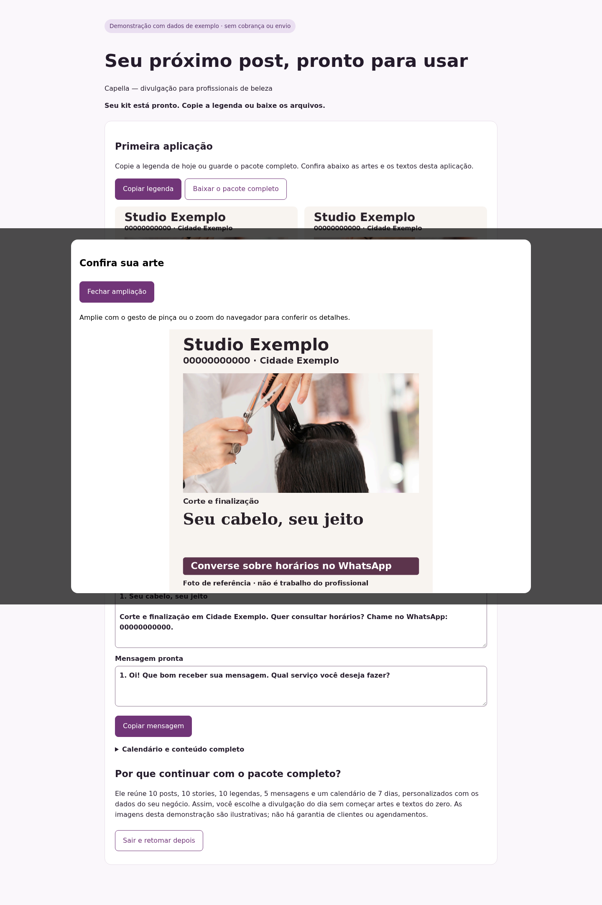
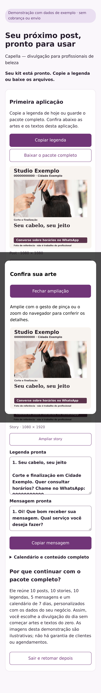

# Capella: referências visuais e leitura da demonstração v2

## Evidência e decisão

Na solicitação 3786, a autorização de US$ 30 cumulativos foi registrada no produto
e a revisão 843 recebeu corretamente o contexto após o PR 5719. Psique pediu ajuste:
os blocos abstratos da demonstração não representavam os serviços e os textos eram
pequenos. A homologação técnica 834 não comprovava qualidade comercial.

Foram comparados três caminhos: repetir o parecer sem mudar o artefato (não resolve
a causa); gerar imagens pagas (fora da autorização audiovisual); compor uma nova
demonstração com fotografias licenciadas, locais e rastreáveis (adotado). O acervo
v2 contém cinco referências por especialidade, utilizadas em dez composições.
Não representa trabalhos das profissionais e não recebe aprovação comercial implícita.
Fontes, licença e hashes ficam no manifesto versionado e no recibo do compositor,
separados dos 36 arquivos úteis. A biblioteca comercial aprovada continua separada.

## Matriz definida antes da validação

| Área | Aceite |
| --- | --- |
| Conteúdo | Seis especialidades, fotografia pertinente, nome/contato/convite legíveis e identificação de referência |
| Origem | Licença, hash, perfil e cinco imagens distintas conferidos; fonte ausente ou divergente bloqueia |
| Caminho feliz | Backend, compositor e navegador reais; 36 arquivos, copiar, baixar, ampliar e recuperar |
| Isolamento | Dois produtos sintéticos, sem troca de especialidade ou versão e sem contatos reais |
| Falhas | Perfil desconhecido, origem inválida, callback alterado e revisão desatualizada recusados |
| Compatibilidade | v1 e suas provas preservadas; v2 exige seleção explícita em novo contexto |
| Navegadores | Chromium desktop, iPhone 15 Pro e Pixel 7 emulados; ampliação e fechamento por teclado |
| Observabilidade | Origem visual persistida junto ao artefato, fora da tela e do ZIP funcional |
| Comercial | Zero chamada de geração, pagamento ou anúncio; testes não contam como compras ou margem |

## Limites

A mudança visual exige versão/ciclo sucessor conforme o cânone de aprendizado.
O ciclo 15, suas provas e seu parecer permanecem históricos. Autorizações não são
transferidas automaticamente. O saldo conhecido após a revisão 843 é US$ 4,1743364
dos US$ 30 (consumo estimado US$ 25,8256636, não fatura conciliada).

## Resultado da validação

A primeira rodada confirmou os caminhos históricos e encontrou o código v2 ainda
recusado na validação HTTP. A segunda chegou à composição real, mas o pacote
fotográfico de 27 MiB foi recusado antes do controller: seu base64 excedia o limite
de string do parser JSON. A regressão reproduz esse limite e valida transporte
multipart autenticado, sem ampliar o parser global. O ZIP e a origem são preservados
para replay. Os testes afetados passaram após a correção.

Uma execução paralela de Maven foi encerrada pelo limite de memória da sandbox;
as próximas validações foram serializadas. O compositor também limita os pixels
carregados preservando proporção e resolução útil, sem reduzir o contrato de saída.

O transporte binário aceitou os primeiros pacotes; a cobertura ampliada encontrou
`OOMKilled=true` no MySQL local, cujo diretório inteiro era tmpfs de 512 MiB. O
runner passou a usar volume nomeado exclusivo e descartável, removido pelo mesmo
`down --volumes`, com buffers limitados. Não foi alterado nenhum banco produtivo.

O pacote de sobrancelhas revelou um segundo limite real: 34 MiB ultrapassavam o
máximo de 32 MiB. A composição agora compacta os canais de cor com desvio máximo
de 2/255, preservando dimensão e legibilidade. A regressão exige que cada uma das
seis especialidades permaneça no limite. Na rodada final, os pacotes variaram de
14.854.885 a 20.168.219 bytes. As 30 composições iniciais foram inspecionadas, com
enquadramento próprio por fotografia; fontes e bytes originais permanecem íntegros.

A rodada final de 27/10/2026 passou com backend, compositor, MySQL 5.7 e Chromium:
12 pacotes (seis especialidades em dois produtos), nove cenários/dispositivos,
21 capturas, três callbacks de Psique, Têmis e gate simulados. A prova técnica v2
foi também validada pelo contrato Java real. Os caminhos anteriores de unhas e
barbearia passaram antes, com suas matrizes de nove cenários e seis callbacks.

Foram aprovados os testes unitários pertinentes de backend (76 testes de kit),
compositor (suíte de 74 testes, com o único defeito de transporte corrigido e os
casos afetados repetidos), worker, quatro testes do formulário e TypeScript.
A última rodada do compositor teve nove testes aprovados. O pacote de evidências
reuniu 677 arquivos/164 manifestos e seus 16 testes passaram. `bash -n` e ShellCheck
aprovaram o runner. As JVMs locais usam limites finitos, coletor serial e pool
reduzido; a topologia e o volume temporários foram removidos ao final.

A ampliação mostra a arte inteira; a captura da arte e sua ligação à recuperação
são obrigatórias na v2. Perfis v1 preservam seu contrato anterior. A atestação
Mira v53 comprova apenas compatibilidade do código compartilhado, sem renovar
pareceres, custo, autorização ou publicação de Mira.

Testes locais não são aprovação independente por modelo, autorização comercial,
compra nem contribuição comprovada. A adoção exige pareceres próprios da nova
versão; reversão mantém `beauty-v1` disponível e não altera sessões históricas.
