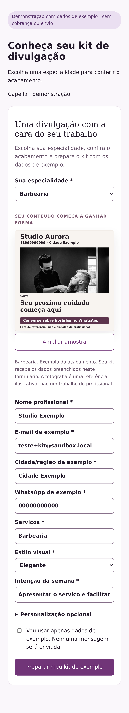

# Capella — entrada, artes e revisão visual

## Evidência e decisão

Em 30/10/2026, o MCP confirmou o produto 7, ciclo 17, experimento 110, versão
`capella-beleza-v2`, ainda sem homologação dessa implementação. A tarefa 843 da versão
anterior retornou `ADJUST`, com pertinência visual 2/5 e prazer 2/5. Não houve aprovação
da nova versão. As aprovações históricas 686/746 qualificavam o fluxo funcional, com
reservas explícitas sobre as artes abstratas. Cada cenário recebeu somente a tela final.

O código capturava `BRIEFING` apenas no modo técnico, não na revisão independente.
O prompt solicitava estética, mas o schema sintético só admitia texto livre em
`visualAudit`: não havia gate de acabamento premium por superfície. A prévia do formulário
era um degradê com texto, mesmo na família v2 que já possui referências licenciadas.

| Alternativa | Benefício | Risco / esforço | Decisão |
| --- | --- | --- | --- |
| Reforçar somente o prompt | Pequeno esforço | Não fecha falta de pixels nem aprovação contraditória | Descartada |
| Criar outro agente/revisor visual | Independência adicional | Duplica fila e custo de uma responsabilidade de Psique | Descartada |
| Vincular capturas e qualidade estruturada ao fluxo existente | Corrige cobertura e aceite, reutiliza compositor/licenças | Ajuste de contratos e regressões, sem novo provedor | Adotada |

## Matriz de aceite local

| Área | Verificação |
| --- | --- |
| Prévia | Seis especialidades v2 mostram PNG do compositor existente, com origem e hash; v1 não recebe fotografia de outra versão |
| Interação | Seleção rápida não mostra imagem da opção anterior; imagem ausente apresenta falha honesta; nenhum custo/evento comercial |
| Captura | Entrada, resultado, post e story enviados como pixels no cenário independente; mesma sessão, identidade e dispositivo |
| Qualidade | Aprovação sem evidência, nota insuficiente, placeholder ou déficit crítico é recusada; ajuste é preservado |
| Segurança | SAFETY não produz pacote e não exige peça inexistente; versão antiga preserva histórico |
| Fluxo real | Backend + compositor + MySQL locais, upload/modelo simulados; callback e gate com provas corretas |
| Regressão | Produto/ciclo alternativos e um caminho anteriormente válido, sem exceções por ID |
| Dispositivos | Chromium desktop, iPhone 15 Pro e Pixel 7; carregamento, teclado, layout e inspeção visual |
| Observabilidade | IDs, hashes, momentos, resposta bruta e causa; tráfego sintético separado de vendas |

Métrica técnica: nenhuma aprovação nova de kit sem cobertura visual e sem avaliação de
acabamento por captura. Hipótese comercial: demonstração pertinente e legível melhora a
percepção de valor; impacto em conversão e vendas permanece desconhecido até medição real.

## Resultados

O backend publicado foi identificado pelo MCP em 30/10/2026 às 02:16 UTC como
`161f6365e66b05a4997f589dcf79285a66a948a7`, mesma base desta correção. A consulta de
logs de Psique pelo identificador 843 não encontrou linhas na retenção disponível;
o diagnóstico histórico usa o resultado e os recibos persistidos no banco.

A prévia usa os seis PNG do compositor existente, com origem e hash em
`private-kit-v1/samples/manifest.json`. O endpoint aceita somente os seis códigos v2,
sem sessão, cobrança ou composição. O estado legado não recebe imagens de outra versão.
Seleção rápida, falha de carregamento e ampliação foram exercitadas em desktop,
iPhone 15 Pro e Pixel 7 emulados. Safari nativo não foi executado.

A matriz local encontrou uma expectativa antiga que exigia a descrição do serviço na
prévia; o texto foi preservado junto da nova explicação. A execução simultânea das suítes
atingiu os limites de 3 GiB/512 processos da sandbox; as validações seguintes foram isoladas.
Na revisão mobile, capturar a página longa por trás do modal encerrou o renderer durante
o screenshot. As artes novas usam `FOLD` do viewport, com verificação de que a peça inteira
cabe na imagem, mantendo a escala do dispositivo. Entrada e resultado continuam `FULL_PAGE`
em pixels CSS, como no capturador geral de Psique; o DPR 3 multiplicava por nove a área da
página inteira e o cgroup registrou novos encerramentos por memória. Não há recorte que
esconda partes do formulário, e as peças mantêm a resolução nativa do dispositivo.
A verificação da captura integral revelou também que o cabeçalho do modal empurrava parte
do story para fora do viewport mobile. O modal agora distribui o espaço entre cabeçalho e arte,
e a regressão confirma o quadro inteiro inclusive em 393 × 659, além do fechamento por botão.

Nenhum parecer pago ou autorização comercial é produzido por esta matriz. As respostas do
modelo nos testes de integração são fixtures explicitamente sintéticas, não avaliações de Psique.

## Execuções e compatibilidade

- Backend: 77 testes do kit aprovados, incluindo seis imagens, origem, hash e rejeição de caminhos inválidos.
- Executor: suíte com 253 testes, sem falhas (13 integrações condicionais não executadas nessa rodada); após o ajuste de viewport, os contratos de captura e qualidade foram reexecutados.
- Navegador: 67 testes aprovados em sequência, incluindo os harnesses de Mira, Vega e Alcyone, prévia de kit, recuperação e capturas mobile.
- Integração local: MySQL 5.7, backend e compositor reais; seis especialidades em duas identidades, 36 arquivos por pacote, nove cenários técnicos, três revisões com upload/modelo simulados, callback, Têmis e gate. Execução concluída em 30/10/2026, em `e2e-accepted`; topologia temporária removida.
- Legado: matrizes nails-v1 e barber-v1, seus callbacks independentes e gate passaram antes dos ajustes de captura mobile; contratos de replay histórico permanecem protegidos.
- Construção de evidências: novos manifestos de compatibilidade de Mira e Vega referenciam o runner alterado. O suplemento operacional v7 de Vega preserva integralmente critérios, capturas, horários e recibos anteriores e acrescenta somente a atestação desta mudança do executor.

A validação adicional de catálogo/contratos do backend verificou a retenção da instrução v6 no inventário histórico e a cadeia de compatibilidade do runner. O gate novo é restrito ao runtime de kit; os prompts e os scripts de execução dos outros produtos permanecem iguais. Não foi renovado parecer nem autorização comercial de outro produto.
